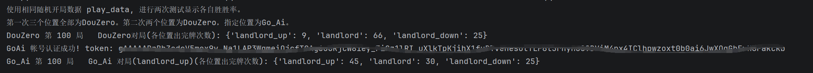
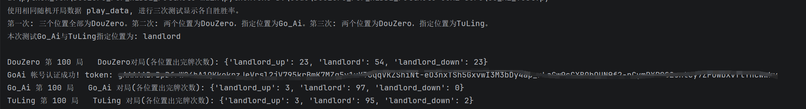
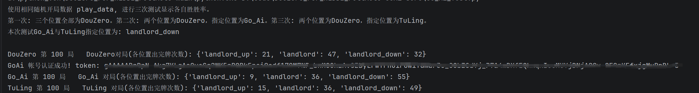

# Go_Ai 斗地主模型 · DouZero_For_HLDDZ_FullAuto 集成示例

> 基于 DouZero_For_HLDDZ_FullAuto 示例，展示与演示 Go_Ai 效果。  
> Go_Ai 是参考 DouZero 原理从零全新开发的 **MOE 架构** 斗地主模型，与原DouZero模型、训练体系无任何关联。

---

## 📌 项目说明

- 本项目 DouZero 相关代码基于 [DouZero](https://github.com/kwai/DouZero) 与 [DouZero_For_Happy_DouDiZhu](https://github.com/tianqiraf/DouZero_For_HappyDouDiZhu)。
- 感谢 **girgle（QQ群马云）** 对新版欢乐斗地主进行适配，当前仓库代码已支持新版欢乐斗地主。
- 环境配置请移步项目 **DouZero**。

---

## 📁 文件说明

| 文件 | 说明 |
| :--- | :--- |
| `main.py` | 将 DouZero 替换为 **Go_Ai** 的主文件 |
| `main_old.py` | 原版主文件 |
| `Go_Ai_Test.py` | Go_Ai 与 DouZero 对战测试程序，直接运行即可观察胜率对比数据 |
| `my_agent.py` | Go_Ai Agent 模块。正式使用前需注册账号，并将账号密码填入 `server_info` 字典中 |

### 🔑 账号注册

- 注册网址：<http://ai.go129.com:8000/register>
- 注册免开通，个人免费使用。
- **每个账号禁止并发连接，禁止重复登录，切记！**

---

## 📊 胜率对比
提示: 以下基准测试是在队友、敌人为DouZero时取得的，并不代表实际场景中的能力。测试完成后log目录中有出牌记录日志，可以贴给大模型查询是否有明显失误。

### landlord_up 胜率对比


### landlord 胜率对比


### landlord_down 胜率对比


---

## 🤝 交流群

- Go_Ai 相关讨论 QQ 群：**324785043**

---

## 🧠 Go_Ai Agent 极简说明

### 介绍

Go_Ai 参考 DouZero 原理全新开发，因此在使用习惯与风格上接近 DouZero，但更加简化。

核心流程仅三步：

1. `newgame()` — 创建开局
2. `step()` — 记录对家出牌，获取 AI 最优出牌策略
3. `game_over()` — 检测是否结束

原来使用 DouZero 的代码，仅需几行简单修改即可切换至 Go_Ai 策略，几乎无需付出学习与修改代价，即可快速带来胜率提升。

### 完整使用示例（可直接复制）

```python
import my_agent

# 1. 创建 Agent
go_env = my_agent.My_Agent()

# 2. 全新开始一局
# 传入：Go_Ai 位置、初始手牌 env、三张地主牌 env
go_env.new_game(go_ai_position, user_hand_cards_env, three_cards_env)

# 3. 获取自己当前手牌
# 传入 env 位置。Go_Ai 中一个 Agent 可同时扮演三个位置，
# 因此获取自己当前手牌时需要传入位置。
my_cards = go_env.get_my_hand_cards(go_ai_position)

# 4. 兼容 DouZero 的 Step
# 唯一区别：要传入两个位置 (env 位置, 当前出牌位置, 出牌动作内容 env)

# 4.1 记录别家出牌时传入
action_message, action_list = go_env.step(go_ai_position, position=now_pos, action=action)

# 4.2 AI 出牌时传入（action 为 None）
action_message, action_list = go_env.step(go_ai_position, position=now_pos, action=None)

# 5. 检测对局是否结束
# 未结束返回 False；结束返回最后出完的位置
# （landlord / landlord_down / landlord_up）。注意需传入 env 位置。
game_over = go_env.game_over(go_ai_position)
